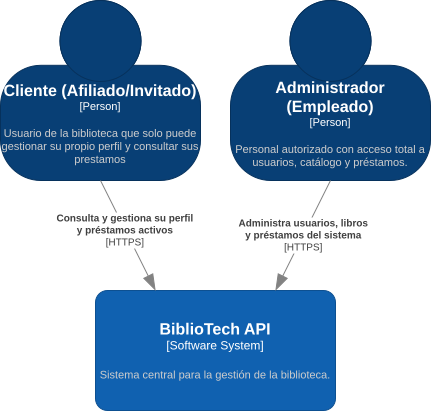

# 3. Contexto y Alcance

## Descripción General

Esta sección define los límites de BiblioTech API, identificando sus socios de comunicación externos e interfaces. Distingue entre el contexto de negocio (interacciones específicas del dominio) y el contexto técnico (protocolos, canales y formatos de comunicación).

## Contexto de Negocio

BiblioTech API interactúa con dos actores humanos principales, apoyándose en un motor de base de datos relacional para la persistencia:

- **Administrador (Empleado)**: Personal autorizado que consume la API para gestionar usuarios, administrar el catálogo de libros, registrar préstamos y consultar el estado de la biblioteca.
- **Cliente (Afiliado/Invitado)**: Usuario de la biblioteca que consume la API para iniciar sesión, gestionar su propio perfil y consultar el estado de sus préstamos activos.

### Diagrama de Contexto (C4 - Nivel 1)

Vista general de los actores que interactúan con BiblioTech API. La interacción indica el protocolo de comunicación utilizado (HTTPS / REST).

    

> Fuente editable: [`docs/diagrams/DiagramaContexto.drawio`](../diagrams/DiagramaContexto.drawio).

## Contexto Técnico

Los canales, protocolos y formatos de comunicación entre BiblioTech API y sus contrapartes técnicas son:

| Contraparte | Canal | Protocolo / Formato | Autenticación |
| :--- | :--- | :--- | :--- |
| **Administrador (Empleado)** | HTTP(S) | JSON REST | JWT (`Authorization: Bearer <token>`) en endpoints protegidos |
| **Cliente (Afiliado/Invitado)** | HTTP(S) | JSON REST | JWT (`Authorization: Bearer <token>`) en endpoints protegidos |
| **MariaDB** | JDBC | SQL | Usuario/contraseña configurados en `application.properties` |

### Detalles por canal

- **API HTTP/JSON**: los actores consumen la API REST sobre HTTP(S). La autenticación viaja como `Authorization: Bearer <JWT>`. El endpoint de login es público, el resto requiere token.
- **Persistencia JDBC**: la API lee y escribe en MariaDB a través del driver JDBC vía Spring Data JPA.

## Fuera del Alcance

Para mantener el proyecto enfocado en los requerimientos obligatorios y los criterios de evaluación, se delimita explícitamente lo siguiente:

- No se implementará una interfaz de usuario (UI); la interacción será exclusivamente vía API REST (probada con Postman y Swagger).
- No se implementará un endpoint para registrar la devolución física de un libro (el alcance solo cubre la creación y consulta de préstamos).
- No se implementará un sistema de notificaciones por correo electrónico ni recuperación de contraseñas.
- No se implementará paginación en los listados (dado el volumen bajo de datos esperado para la prueba).

---

## Notas de diseño

- **El Diagrama de Contenedores (C4 - Nivel 2)** y **el Diagrama de Componentes (C4 - Nivel 3)** se documentan en la [Sección 5: Vista de Bloques de Construcción](./05_vista_de_componentes.md), donde se descompone la estructura interna del sistema.
- La vista de despliegue (Docker, infraestructura) se documentará en la [Sección 7](./07_vista_de_despliegue.md).
