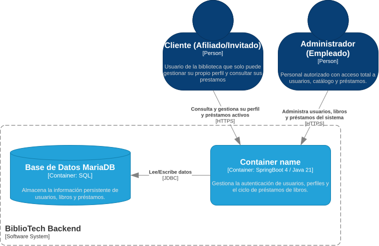
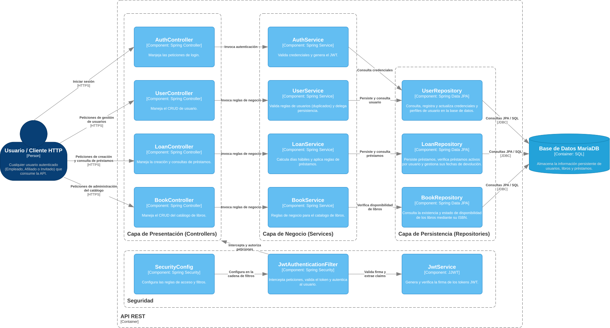
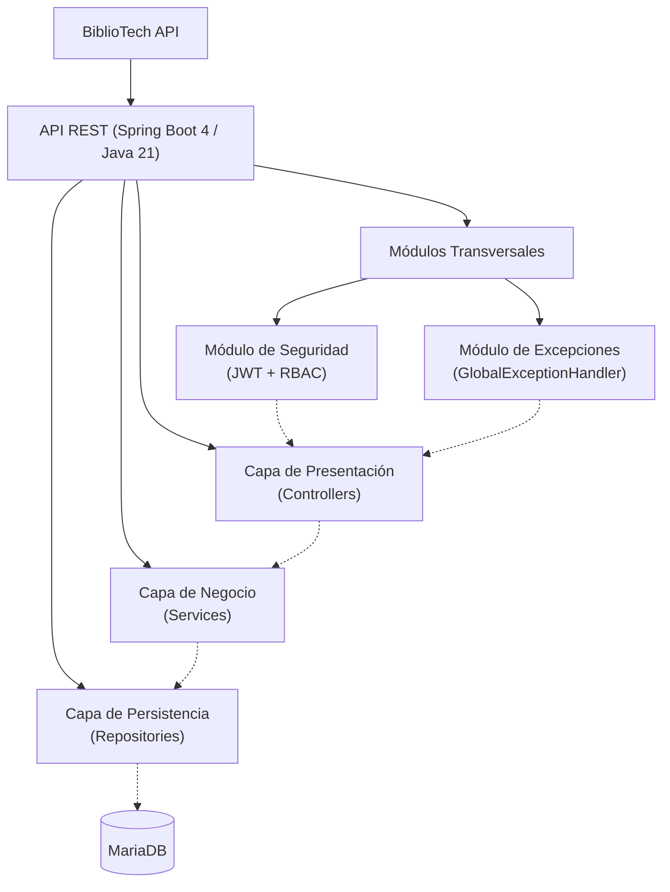

# 5. Vista de Bloques de Construcción

## Descripción General

La Vista de Bloques de Construcción proporciona una descomposición estática de BiblioTech API, mostrando la estructura jerárquica de sus componentes. Esta sección desglosa el sistema en "cajas blancas" (contenedores de alto nivel) que contienen "cajas negras" (componentes) y describe cómo se organizan.

## Nivel 1: Contenedores (C4 - Nivel 2)

En el nivel más alto, BiblioTech API se compone de los siguientes bloques desplegables y de datos:

- **BiblioTech Backend**: Aplicación Spring Boot 4 / Java 21 que contiene la lógica de negocio (MVC por capas), la seguridad (RBAC) y los controladores REST.
- **Base de Datos MariaDB**: Almacena la información persistente de usuarios, libros y préstamos. Accedida por JDBC desde el backend mediante Spring Data JPA.

    

> Fuente editable: [`docs/diagrams/DiagramaContenedor.drawio`](../diagrams/DiagramaContenedor.drawio).

## Nivel 2: Componentes (C4 - Nivel 3)

El contenedor **API REST** se descompone en componentes organizados bajo el patrón **MVC por Capas (Package by Layer)**, ideal para el tamaño del dominio de esta prueba. La lógica de negocio está totalmente aislada de la capa de presentación.

### Capa de Presentación (Controllers)
- *Responsabilidad*: Recibir las peticiones HTTP, validar el formato de entrada (DTOs) y delegar la ejecución. No contienen lógica de negocio.
- *Componentes*: 
  - `AuthController` (Gestión de login).
  - `UserController` (CRUD de usuarios y auto-gestión).
  - `LoanController` (Creación y consultas de préstamos).
  - `BookController` (CRUD del catálogo de libros).

### Capa de Negocio (Services)
- *Responsabilidad*: Contener todas las reglas de negocio, cálculos (días hábiles), validaciones de estado y transacciones.
- *Componentes*: 
  - `AuthService` (Validación de credenciales).
  - `UserService` (Reglas de usuarios y validación de duplicados).
  - `LoanService` (Reglas de préstamos y cálculo de fechas).
  - `BookService` (Reglas del catálogo).

### Capa de Persistencia (Repositories)
- *Responsabilidad*: Interactuar con MariaDB a través de Spring Data JPA.
- *Componentes*: `UserRepository`, `LoanRepository`, `BookRepository`.
- *Entidades (no mostradas en el diagrama por simplicidad)*: `User`, `Loan`, `Book`.

### Módulos Transversales
Estos módulos no pertenecen a un dominio funcional de negocio, sino que proveen infraestructura y servicios compartidos a toda la API. En el diagrama se agrupan bajo la caja **Seguridad**.
- **Seguridad (`SecurityConfig`, `JwtAuthenticationFilter`, `JwtService`)**: Interceptan peticiones para validar el token JWT, extraer los claims y aplicar el Control de Acceso Basado en Roles (RBAC).
- **Manejo de Errores (`GlobalExceptionHandler`)**: Captura las excepciones lanzadas por los controladores y servicios, y las transforma en respuestas HTTP estandarizadas (400, 401, 403, 404).

    

> Fuente editable: [`docs/diagrams/DiagramaComponente.drawio`](../diagrams/DiagramaComponente.drawio).

> **Nota sobre el diagrama de componentes:** Por claridad visual, las entidades JPA (`Usuario`, `Libro`, `Prestamo`) y los DTOs no se representan como componentes independientes, pero forman parte de la capa de persistencia y presentación respectivamente.

## Jerarquía de Bloques

## Motivación

Descomponer BiblioTech API en bloques de construcción permite una mejor modularidad y mantenibilidad. Al organizar el sistema estrictamente en capas (Controladores, Servicios, Repositorios) y separar los módulos transversales (Seguridad, Excepciones), se garantiza el principio de responsabilidad única (SRP) y se refleja fielmente la estructura del código en el repositorio, evitando la sobreingeniería.
