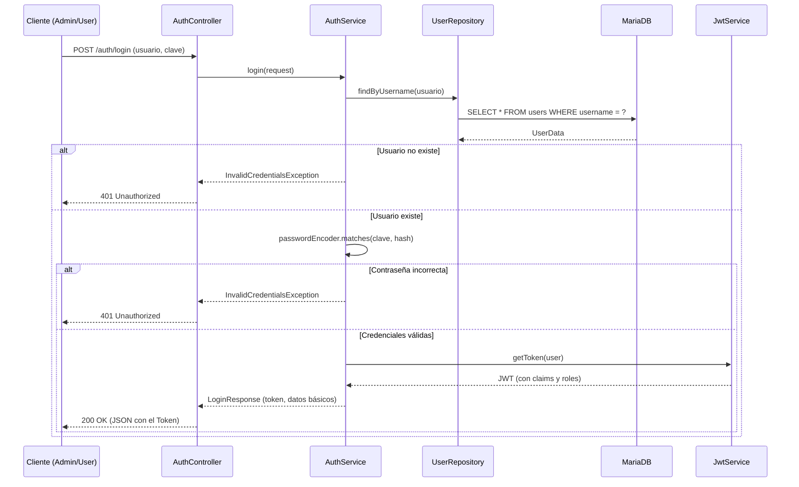
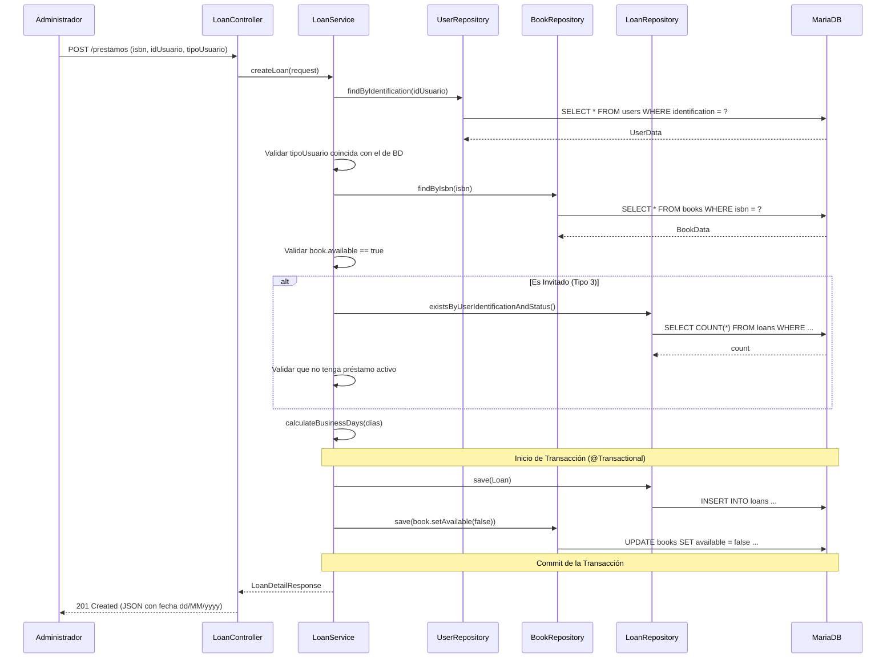
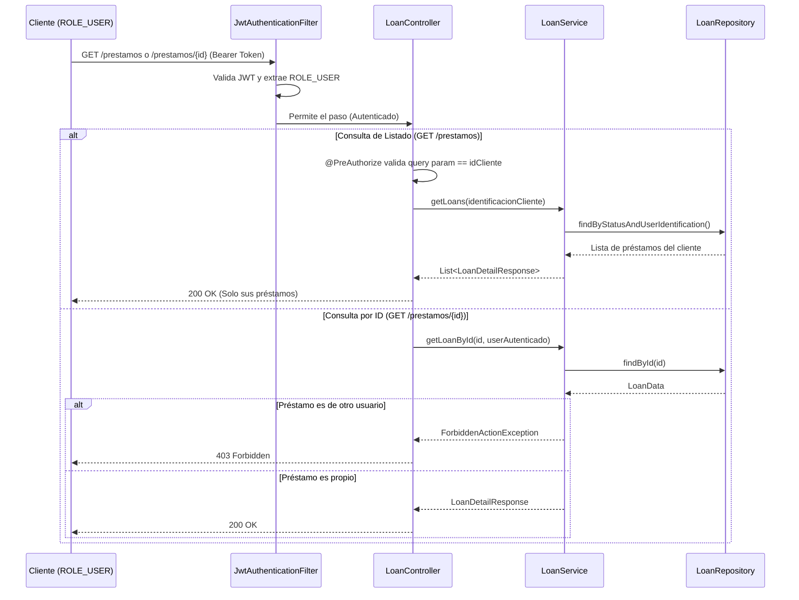

# 6. Vista de Tiempo de Ejecución

## Descripción General

La Vista de Tiempo de Ejecución describe el comportamiento dinámico y las interacciones entre los bloques de construcción de BiblioTech API durante escenarios clave. Los escenarios siguientes están definidos en las historias de usuario ([`epicas-y-hu.md`](../epicas-y-hu.md)) y demuestran cómo fluye la información a través de las capas (Controlador → Servicio → Repositorio).

## Escenario 1: Inicio de Sesión y Obtención de Token (HU-001)

- **Desencadenante**: Un usuario (Admin o Cliente) envía sus credenciales al endpoint `/auth/login`.

- **Secuencia**: El sistema recibe las credenciales, busca al usuario en la base de datos y valida la contraseña usando BCrypt. Si son correctas, el `JwtService` genera un token firmado con los datos del usuario y su rol (`ROLE_ADMIN` o `ROLE_USER`), el cual es retornado al cliente para futuras peticiones.

- **Gestión de Errores**: Credenciales incorrectas → `401 Unauthorized`; Campos vacíos o JSON mal formado → `400 Bad Request`.

## Escenario 2: Creación de Préstamo y Cálculo de Fechas (HU-007, HU-008)

- **Desencadenante**: Un Administrador envía una petición al endpoint `/prestamos` con el ISBN, la identificación del usuario y el tipo de usuario.

- **Secuencia**: El `LoanService` ejecuta una serie de validaciones estrictas (tipo de usuario válido, usuario existente, libro disponible y regla especial para invitados). Si todo es correcto, calcula la fecha de devolución omitiendo fines de semana usando el método `calculateBusinessDays`. Finalmente, guarda el préstamo y actualiza el estado del libro a no disponible dentro de una misma transacción (`@Transactional`).

- **Gestión de Errores**: Libro no disponible, tipo de usuario inválido, o invitado con préstamo activo → `400 Bad Request`; Libro o usuario no encontrado → `404 Not Found`.

## Escenario 3: Consulta Segura de Préstamos (HU-009, HU-010)

- **Desencadenante**: Un Cliente consulta el listado de préstamos (`/prestamos`) o un préstamo por ID (`/prestamos/{id}`).

- **Secuencia**: El `JwtAuthenticationFilter` valida el token y extrae el rol. Si es un Cliente (`ROLE_USER`), el sistema aplica reglas de seguridad para evitar fugas de información (IDOR). En el listado, la anotación `@PreAuthorize` asegura que solo pueda filtrar por su propia identificación. Si consulta por ID, el `LoanService` verifica que el préstamo le pertenezca antes de retornarlo.

- **Gestión de Errores**: Cliente intenta ver préstamos de otros (vía query param o ID) → `403 Forbidden`; Préstamo no encontrado → `404 Not Found`.

## Motivación

Esta vista es esencial para comprender las interacciones dinámicas de BiblioTech API durante operaciones críticas como la autenticación, la creación transaccional de préstamos y las validaciones de seguridad. Al documentar estos escenarios a partir de las historias de usuario y los diagramas de secuencia, se garantiza que cualquier desarrollador o evaluador comprenda el flujo exacto de la lógica de negocio y las capas involucradas antes de sumergirse en el código.