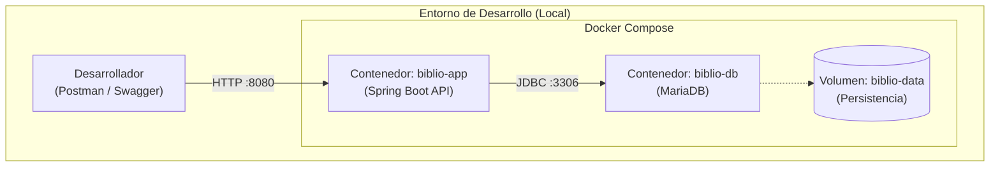
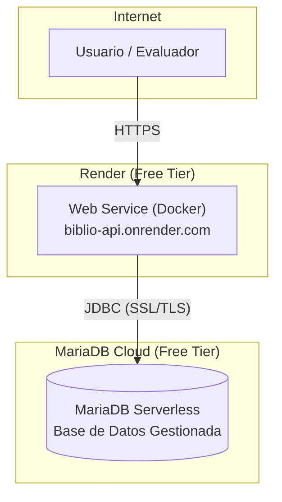

# 7. Vista de Despliegue

## Descripción General

Esta sección describe la infraestructura técnica necesaria para ejecutar BiblioTech API, incluyendo la topología de contenedores, la estrategia de despliegue en la nube y la configuración de los entornos.

## Estrategia de Contenerización (Docker)

Para satisfacer diferentes escenarios de desarrollo y despliegue, se utiliza una estrategia de **Docker Compose componible**. Esto permite levantar los servicios de forma granular sin duplicar configuraciones.

### Archivos Compose

1. **`docker-compose.yml` (Base):** Define la configuración canónica. Levanta el backend (`app`) y la base de datos (`db`) como servicios. Es el archivo que se usa por defecto.
2. **`docker-compose.app-only.yml` (Override para Nube):** Solo define el servicio `app`. Se usa en entornos donde la base de datos es un servicio externo gestionado (ej. Render + MariaDB Cloud). Las credenciales de la BD se inyectan mediante variables de entorno.
3. **`docker-compose.db-only.yml` (Override para Desarrollo Local):** Solo define el servicio `db`. Permite a los desarrolladores levantar únicamente la base de datos en un contenedor y ejecutar la API REST desde su IDE local para un ciclo de retroalimentación más rápido.

### Diagrama de Contenedores (Nivel 1)

El siguiente diagrama muestra la topología de los contenedores en un entorno de desarrollo local (usando el archivo base).

## Despliegue en la Nube (Plan Gratuito)

Para la entrega de la prueba, se ha optado por un despliegue utilizando servicios en la nube con capa gratuita.

### Arquitectura de Despliegue

- **Backend (API REST):** Se despliega en **Render** como un **Web Service** de tipo *Docker*. Render construye la imagen usando el `Dockerfile` del proyecto y la expone con un enlace público.

- **Base de Datos (MariaDB):** Se utiliza **MariaDB Cloud Serverless** (capa gratuita "para siempre"). Es un servicio de base de datos gestionado que ofrece un endpoint público y credenciales de acceso seguras.

### Diagrama de Despliegue (Nivel 2)

### Configuración de Entornos y Secretos

La configuración sensible se inyecta en tiempo de ejecución a través de **variables de entorno**, tanto en local (vía archivo `.env`) como en la nube (Render Environment Variables).

| Variable | Descripción | Entorno Local (`.env`) | Entorno Nube (Render) |
| :--- | :--- | :--- | :--- |
| `DB_URL` | URL de conexión JDBC a MariaDB. | `jdbc:mariadb://localhost:3306/bibliotech_db` | `jdbc:mariadb://<host>:<port>/<db>` |
| `DB_USERNAME` | Usuario de la base de datos. | `root` | `<usuario_cloud>` |
| `DB_PASSWORD` | Contraseña del usuario. | `admin` | `<password_cloud>` |
| `JWT_KEY` | Clave secreta para firmar JWT (Base64). | `[valor_local]` | `[valor_cloud]` |

### Limitaciones de los Planes Gratuitos (Trade-offs)

1. **Render (Web Service):** El servicio entra en estado de "suspensión" tras **15 minutos de inactividad**. La primera petición después de este período puede tardar entre 10 y 20 segundos en responder (latencia de arranque en frío).
2. **MariaDB Cloud Serverless:** La capa gratuita está limitada a **10 MCU-horas al mes**. Si se excede este límite, el servicio podría dejar de responder hasta el siguiente ciclo de facturación.
3. **Almacenamiento:** Render no proporciona almacenamiento persistente en su plan gratuito. La persistencia de datos recae exclusivamente en MariaDB Cloud.
