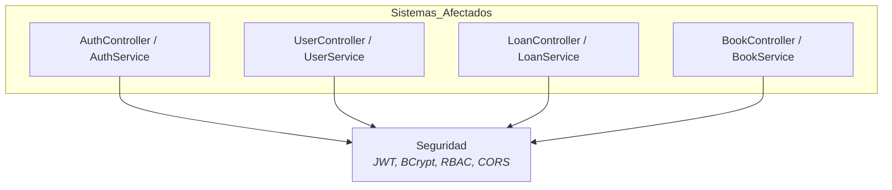
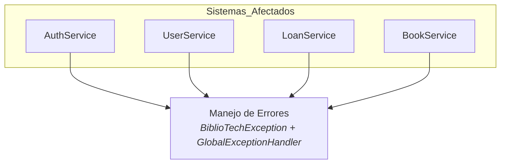
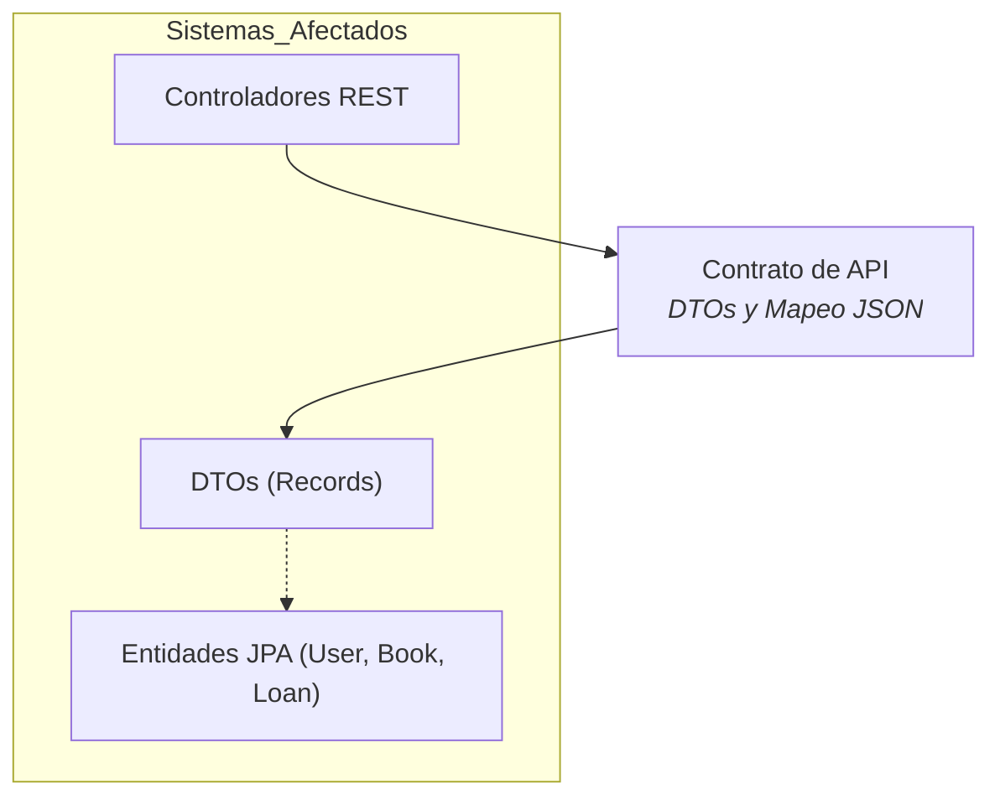
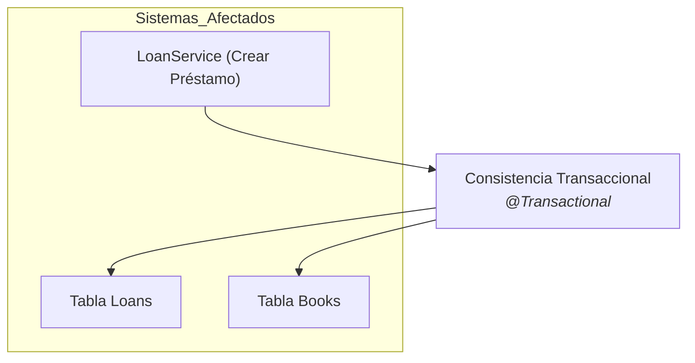
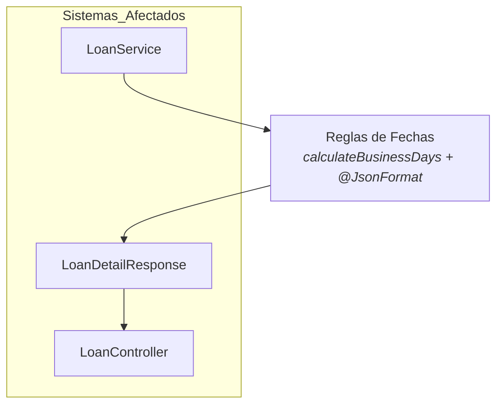
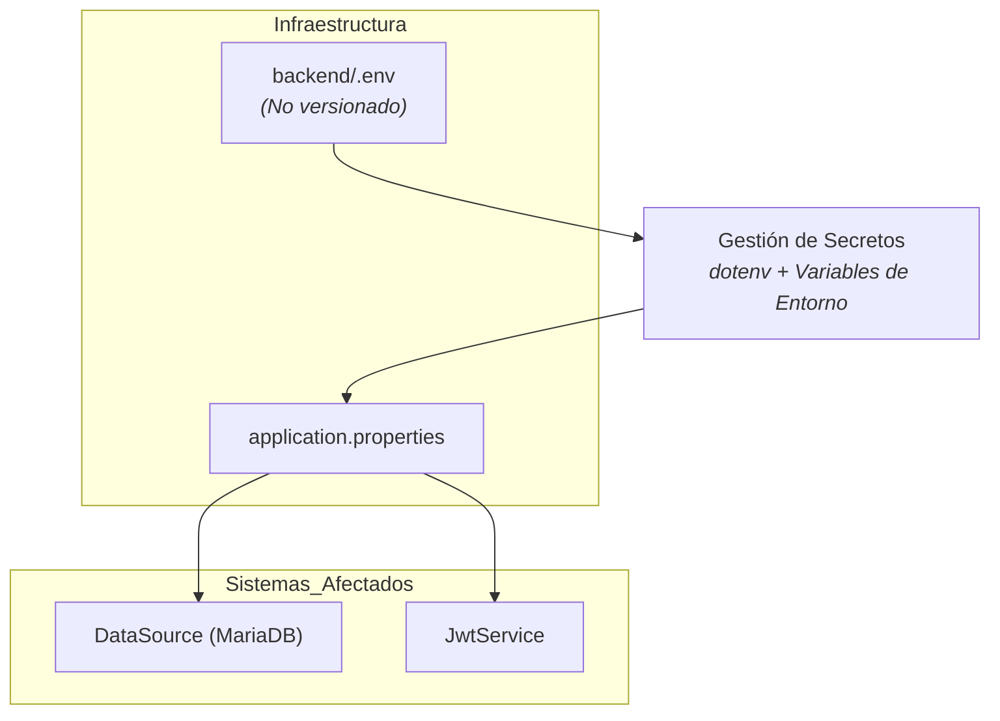
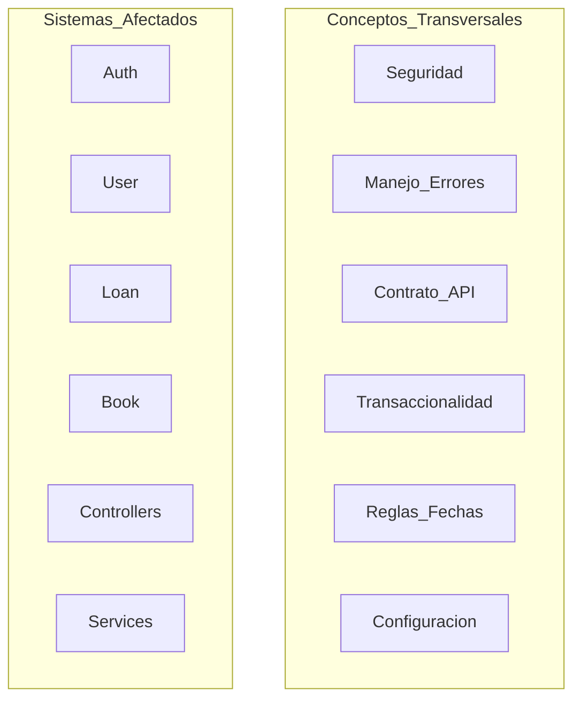

# 8. Conceptos Transversales

## Descripción General

Los conceptos transversales definen los estándares técnicos, principios y soluciones aplicados en toda la arquitectura de BiblioTech API. Estos principios afectan a múltiples componentes o capas, asegurando un enfoque unificado en las prácticas técnicas y mejorando la seguridad y estabilidad del sistema.

## Principales Conceptos Transversales

### 1. **Seguridad (JWT y RBAC)** 

El acceso a las rutas protegidas se controla mediante tokens JWT (firmados con HMAC-SHA256). El `JwtAuthenticationFilter` intercepta cada petición, valida el token, busca al usuario en la base de datos y construye sus autoridades (`ROLE_ADMIN` o `ROLE_USER`) basándose en el `tipoUsuario`. La configuración es *stateless* (sin sesiones en el servidor) y las contraseñas se almacenan utilizando hashing con BCrypt. Además, se aplican políticas CORS explícitas y cabeceras de seguridad HTTP.

### 2. **Manejo de Errores y Validación** 

Las excepciones de negocio heredan de `BiblioTechException`, la cual transporta un `HttpStatus` específico. El `GlobalExceptionHandler` (`@RestControllerAdvice` en el paquete `common.exceptions`) las traduce a una respuesta uniforme `ErrorResponse` (con timestamp, status, mensaje y path). Además, se capturan excepciones de Spring Security para garantizar respuestas HTTP 401 y 403 estandarizadas. La validación de entrada con Jakarta Validation en los DTOs produce errores HTTP 400 automáticos.

### 3. **Contrato de API Desacoplado (DTOs)** 

La API no expone las entidades JPA (`User`, `Book`, `Loan`) directamente. En su lugar, utiliza `record` de Java 21 para definir DTOs de petición y respuesta (ej. `CreateUserRequest`, `LoanDetailResponse`). Los DTOs incluyen anotaciones `@JsonProperty` para mapear las variables en inglés del código a las claves en español exigidas por el contrato de la prueba (ej. `identificacionUsuario`, `fechaMaximaDevolucion`).

### 4. **Consistencia Transaccional** 

Las operaciones que afectan múltiples tablas están protegidas por transacciones de base de datos. El caso más crítico es la creación de un préstamo (`LoanService.createLoan`), donde se debe guardar el registro del préstamo y, al mismo tiempo, actualizar la disponibilidad del libro (`available = false`). El uso de `@Transactional` garantiza que si una de las dos operaciones falla, se haga un *rollback* y no queden datos corruptos o inconsistentes en la base de datos.

### 5. **Gestión de Reglas de Negocio Complejas (Fechas)** 

El cálculo de las fechas de devolución es una regla de negocio transversal. Para evitar dependencias externas, se implementó un algoritmo propio (`calculateBusinessDays`) que suma días hábiles omitiendo sábados y domingos. El sistema usa `LocalDate` para el manejo interno y Jackson (`@JsonFormat`) para serializar y deserializar las fechas strictly en el formato `dd/MM/yyyy` que exige el cliente.

### 6. **Configuración y Gestión de Secretos** 

La configuración sensible se externaliza en un archivo `backend/.env`, el cual se carga mediante la librería `springboot4-dotenv`. Ninguna credencial (contraseñas de base de datos, clave secreta JWT) se versiona en el repositorio de Git. El archivo `application.properties` utiliza variables de entorno para inyectar estos valores (`${DB_URL}`, `${JWT_KEY}`, etc.).

## Vista Consolidada de Conceptos Transversales

El siguiente diagrama resume, a alto nivel, los sistemas afectados y los conceptos transversales definidos. Las relaciones específicas se documentan en detalle en cada subsección.

## Motivación

Estos conceptos establecen un enfoque coherente en estándares técnicos y prácticas de diseño, mejorando la seguridad, la integridad de datos y la mantenibilidad de BiblioTech API. Adoptarlos de forma transversal garantiza que las reglas de negocio críticas se apliquen de manera uniforme y que el sistema cumpla con los altos estándares de calidad exigidos.