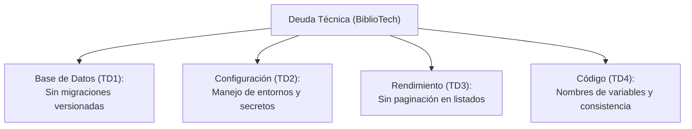

# 11. Riesgos y Deuda Técnica

## Descripción General

Esta sección lista los riesgos y la deuda técnica identificados en BiblioTech API a partir del código implementado y del alcance definido en las épicas/HU. No se incluyen riesgos genéricos; se dividen en **actuales** (verificados en el código) y **potenciales** (derivados del alcance actual).

## Riesgos Actuales

1. **Credenciales del Administrador Inicial Hardcodeadas**
   - **Descripción**: El `DataInitializer` crea el usuario administrador por defecto con credenciales fijas (`admin` / `admin123`).
   - **Impacto**: Alto — Si el sistema se despliega en producción sin cambiarlas, cualquier persona con acceso a la URL podría tomar el control total de la plataforma.
   - **Mitigación**: En un entorno real, estas credenciales deben inyectarse mediante variables de entorno o forzar un cambio de contraseña en el primer inicio de sesión.

2. **Ausencia de Rate Limiting (Protección contra Fuerza Bruta)**
   - **Descripción**: El endpoint `/auth/login` no tiene un límite de intentos. Un atacante podría intentar adivinar contraseñas de forma masiva.
   - **Impacto**: Medio-Alto — Riesgo de denegación de servicio (DoS) o compromiso de cuentas.
   - **Mitigación**: Implementar un sistema de bloqueo temporal por IP/Usuario o integrar Redis para contadores de intentos (fuera del alcance actual).

3. **Falta de Endpoint de Devolución de Libros**
   - **Descripción**: El alcance actual permite crear préstamos y marca el libro como `disponible = false`, pero no existe un endpoint para registrar la devolución y volver a ponerlo en `true`.
   - **Impacto**: Medio — Un libro prestado queda permanentemente inutilizable en el sistema a menos que se modifique directamente en la base de datos.
   - **Mitigación**: Se documenta como una limitación aceptada del alcance. Para una siguiente versión, se debería agregar un endpoint `PATCH /prestamos/{id}/devolver`.

4. **Falta de Pruebas Unitarias Automatizadas**
   - **Descripción**: Aunque el código está estructurado para ser testeable, actualmente no se han implementado las pruebas con JUnit y Mockito.
   - **Impacto**: Medio — Mayor riesgo de regresiones futuras y menor confianza en los despliegues.
   - **Mitigación**: Implementar la suite de pruebas unitarias en la siguiente fase del desarrollo (planificado).

## Riesgos Potenciales (A Escala)

1. **Condiciones de Carrera en Creación de Préstamos**
   - **Descripción**: Si dos administradores intentan prestar el mismo libro (mismo ISBN) exactamente al mismo tiempo, ambos podrían leer `disponible = true` y crear dos préstamos.
   - **Impacto**: Alto — Inconsistencia en la base de datos (un libro prestado dos veces).
   - **Mitigación**: Usar bloqueo optimista (`@Version` en la entidad `Book`) o bloqueo pesimista (`@Lock`) para asegurar la consistencia a nivel de base de datos.

2. **Escalabilidad de los Listados (Sin Paginación)**
   - **Descripción**: Los endpoints `GET /usuarios`, `GET /libros` y `GET /prestamos` devuelven todos los registros usando `findAll()`.
   - **Impacto**: Bajo-Medio (para la prueba) / Alto (en producción) — Problemas de rendimiento y consumo de memoria si el catálogo crece a miles de registros.
   - **Mitigación**: Implementar `Pageable` de Spring Data en el futuro.

## Tabla Resumen de Riesgos

| ID | Título del Riesgo | Categoría | Nivel de Impacto | Sistemas Afectados | Estrategia de Mitigación |
| -- | ----------------- | --------- | ---------------- | ------------------ | ------------------------ |
| R1 | Credenciales Admin Hardcodeadas | Actual | 🔴 Crítico | `DataInitializer` | Externalizar credenciales en V2 |
| R2 | Sin Rate Limiting | Actual | 🟠 Alto | `AuthController` | Implementar bloqueo o Redis |
| R3 | Sin endpoint de devolución | Actual | 🟡 Medio | `LoanController` | Nuevo endpoint en V2 |
| R4 | Sin pruebas unitarias | Actual | 🟡 Medio | Todo el backend | Implementar JUnit + Mockito |
| RP1 | Condición de carrera en préstamos | Potencial | 🟠 Alto | `LoanService` / DB | Bloqueo optimista/pesimista |

## Deuda Técnica

| ID | Categoría | Descripción | Nivel de Impacto | Acción Sugerida |
| -- | --------- | ----------- | ---------------- | --------------- |
| TD1 | Base de Datos | Uso de `ddl-auto=validate` con script manual. No hay migraciones versionadas (Flyway/Liquibase). | 🟡 Medio | Adoptar migraciones antes de producción. |
| TD2 | Seguridad / Config | Orígenes CORS y claves JWT manejados por variables de entorno, pero el default puede ser inseguro si no se configura. | 🟡 Medio | Documentar claramente en el README el archivo `.env.example`. |
| TD3 | Rendimiento | Uso de `.findAll()` sin paginación en todos los listados. | 🟡 Medio | Implementar `Pageable` en los controladores. |
| TD4 | Código | Nombres de variables en `JwtService` (ej. `expiracionMilisegundos`) deben coincidir exactamente con la unidad esperada. | 🟢 Bajo | Revisar y estandarizar nombres de variables. |

## Mapa de Deuda Técnica

## Motivación

Documentar los riesgos y la deuda técnica permite que el equipo y los evaluadores comprendan las limitaciones actuales del sistema frente a un entorno de producción real. Al reconocer estas áreas de mejora (como la falta de paginación o las credenciales iniciales), se demuestra madurez técnica y se establece una hoja de ruta clara para futuras iteraciones.
